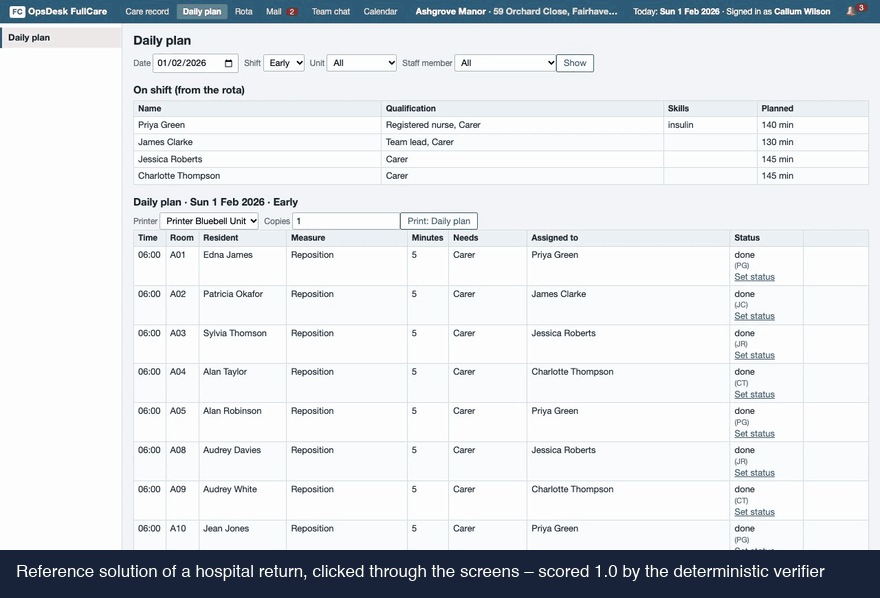

# OpsDesk FullCare – public reviewer sample

OpsDesk FullCare is a self-hosted replica of a care home's nursing software (German and UK editions), built as a
verified reinforcement-learning environment for agents: care record, daily plan, GP instructions, assessments and
handover, next to the rota, mail, team chat and calendar on one clock. Colleagues, GPs, pharmacy and hospital answer
by fixed rules. Computer-use agents work in the browser, tool-use agents call the same functions over HTTP or MCP,
and both change one shared workspace. A deterministic verifier scores the final workspace – no LLM judge.

**RL environments that can't be gamed: proven against reward hacking, difficulty calibrated on real models.**



This repository holds **5 requests with their reference solutions** (public on purpose, so you can score your own
agent), the app image's build context with the runtime and the verifier, and the proof report for exactly these 5
requests. They were generated for this sample from a fresh seed block and are in no sold, training or evaluation set.

| Request | Workflow | Difficulty | Edition | Residents | Reference actions | What the request asks |
|---|---|---|---|---:|---:|---|
| `fc-586d61205620` | Early shift (long tier) | hard | DE | 28 | 145 | the whole early shift as nurse in charge: notes in the mail, the night in the team chat, more mail and chat arrive on the clock; ends with the handover to the late shift |
| `fc-73582e57a857` | Admission | medium | UK | 28 | 21 | a new resident moves in: set up the record from the discharge summary and the chat notes, the admission assessments, the care plan, the medication to the pharmacy |
| `fc-354cca1ca2d3` | GP orders | medium | DE | 28 | 8 | new GP orders for a resident: acknowledge them, take them into the plan, inform the pharmacy where needed |
| `fc-a335d975244c` | Hospital transfer | medium | DE | 28 | 7 | a resident has to go to hospital now: finish and print the transfer documents, inform the relatives, set the resident's status |
| `fc-133cda77edf9` | Hospital return | medium | UK | 28 | 13 | back from hospital: file the discharge letter, the new intolerance, the home's return assessments, care plan, pharmacy |

## Run it in 5 minutes

Needs Docker, curl and Python 3. In this folder:

```bash
./quickstart.sh
```

It builds the image `opsdesk-fullcare-sample:fullcare-0.6.4` from `docker/`, starts request `fc-133cda77edf9`, scores the empty
workspace (**0**), replays the reference solution through the tool API and scores again (**1.0, passed**), then
removes the container. Another request: `./quickstart.sh <request> [port]`. Measured here (Apple M4, macOS 27.0.1, Docker 29.9.2, 2026-11-04): the image built from zero in 12 s (Python base image already downloaded); then each request took about 2 s – empty workspace 0.0, reference 1.0 passed on all 5 (`CHECK.json`).

Your own agent, the browser, MCP and Harbor: [`QUICKSTART.md`](QUICKSTART.md).

## Proven on these 5 requests

| Check | Result |
|---|---|
| Reference solution (API / GUI forms / real browser) | 5/5 · 5/5 · 5/5 score 1.0 |
| Doing nothing | 5/5 score 0 |
| Cheat agents (6 kinds) | 30/30 runs score 0 |
| Near misses (one thing wrong) | 171/171 rejected (highest 0.9975) |
| Equivalent solutions | 26/26 accepted |
| Hack probes | 50/50 passed |

Details, every cheat agent and every near miss: [`PROOF_REPORT.md`](PROOF_REPORT.md) (data in `proofs/`).

## How a frontier model does

| Run | Model | Result |
|---|---|---|
| 14 FullCare requests, 2 attempts each | Claude Opus 5.5 | 17 of 28 attempts solved |

Where it fails: it skips the follow-up work a care home expects, such as ordering a pressure-relief mattress or
telling the pharmacy about a changed medication, and it leaves hospital-transfer sheets incomplete. *Solved* is
`passed: true` (score 1.0). The 5 requests in this sample have not been run on a model. We share calibration across
models, with several attempts per request, under NDA.

## The full environment

| | This sample | OpsDesk FullCare, full set |
|---|---|---|
| Verified requests | 5 | 300 |
| Workflows | 5 | 14 |
| Tools for the agent | – | 76 |
| Editions | DE, UK | DE, UK |
| Longest reference solution | 145 actions (early shift) | the long tier covers whole shifts with handover |
| Cheating agents | 30/30 runs score 0 | 6 kinds score 0 on every request |
| Near misses | 0 of 171 pass | 0 of 6,449 pass |
| Equivalent solutions | 26/26 accepted | all 1,003 score 1.0 |
| Licence | evaluation only | evaluation, training, exclusive on request |

Designed and reviewed, in several rounds, with a practising head of nursing in long-term residential care (35 years
in nursing, 17 as head of nursing). All residents, staff and records are fictional: care records are health data, so no real ones are used.

## How scoring works

- The verifier judges the **final workspace**, not the transcript: care record, daily plan, mails, prints, rota. The
  same checks run whether the agent used the screens or the tools.
- **Gates (any fail → 0):** medication, diagnoses and GP instructions unchanged; no invented values; no changes to
  residents outside the request; health information only to those allowed to have it; the main outcome exists.
- **Then per check** (record, values, assessments, care plan, daily plan, mail, print, rota; in the early shift every
  part of the shift and the handover). Free text counts by its facts, never by style. A claim that the GP was
  informed without the mail scores 0. **Only 1.0 is a pass** (`passed: true`).
- Code: `docker/runtime/opsdesk/fullcare/verifier.py` and `docker/runtime/opsdesk/fullcare/score_workspace.py`.

## In this repository

| Path | What |
|---|---|
| `quickstart.sh`, `QUICKSTART.md` | One-command check; running your own agent |
| `docker/` | Build context of the app image: runtime (apps, tool API, MCP, verifier) and the 5 workspaces |
| `data/tasks/`, `data/host_data/` | The 5 workspaces (request text in `task.json` → `instruction`) |
| `data/private/fullcare/` | The reference solutions of these 5 requests (public in this sample only) |
| `formats/` | Harbor (one task per request), HUD (computer use + MCP), OpenEnv, verifiers-style list, HTTP, MCP |
| `PROOF_REPORT.md`, `proofs/` | The proof report for these 5 requests and its data |
| `replay_gold.py` | Replays a request's reference calls against a running app (standard library only) |
| `demo.gif` | The reference solution of `fc-133cda77edf9`, clicked through the screens (scored 1.0) |
| `CHECK.json` | The quickstart run on all 5 requests, measured |
| `manifest.json`, `SHA256SUMS` | Contents and checksums of every file |

Not in this repository: the task generator, the scenario builders and the reference solver. Evaluation sets never
ship their references (you send the exported workspaces, they are scored with the same verifier); a training licence
seals them into a verifier image.

Licence: **evaluation only** ([`LICENSE.md`](LICENSE.md)) – no training, no redistribution. All homes, residents,
people and values are fictional; not a medical device.

---

Need one for your domain? [getvencur.com](https://getvencur.com) · [info@getvencur.com](mailto:info@getvencur.com)
